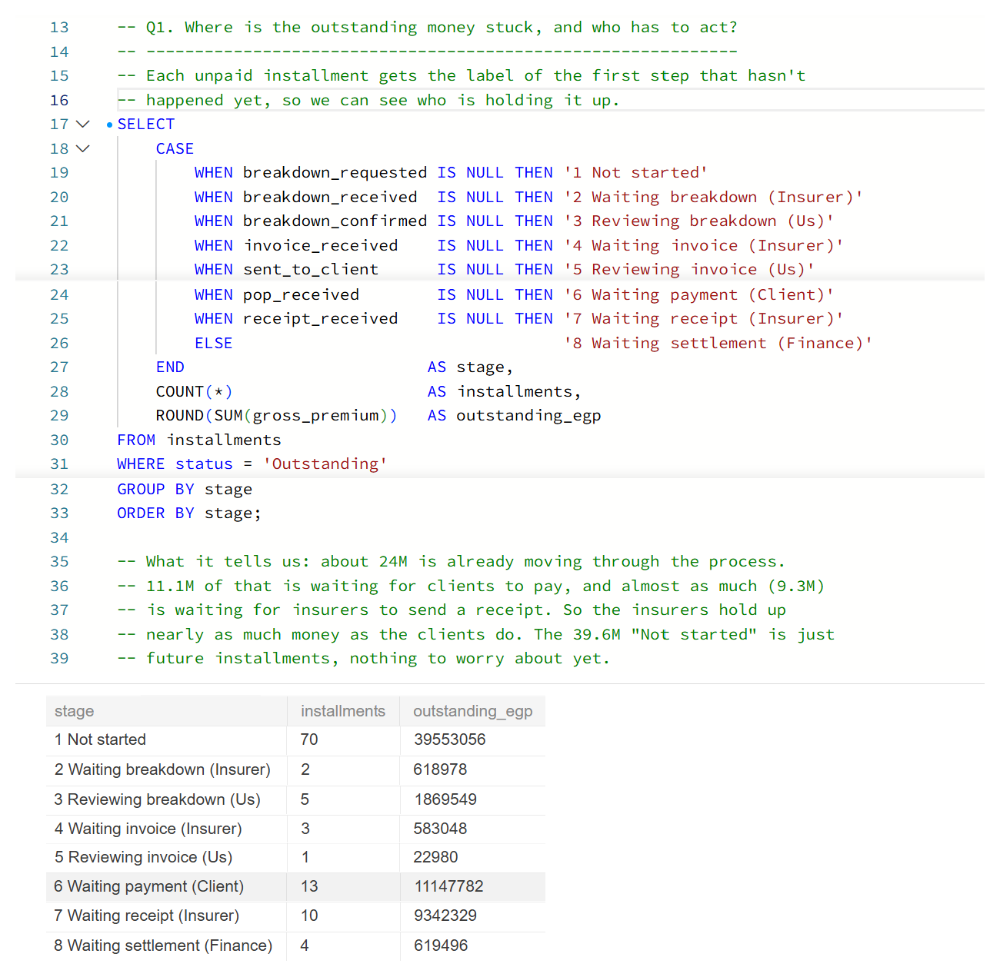
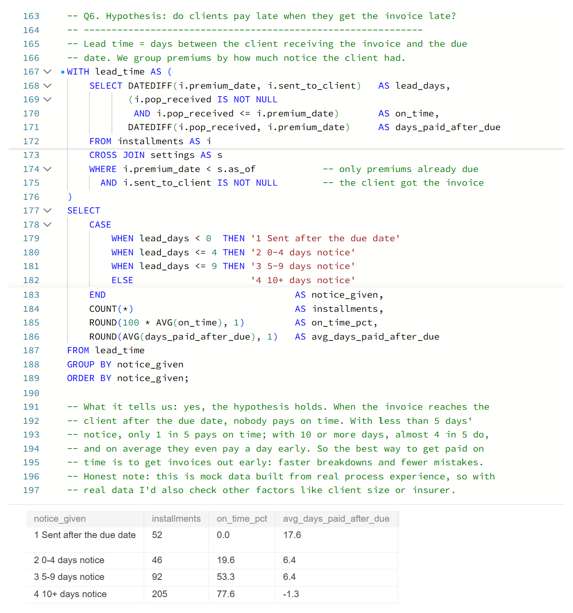
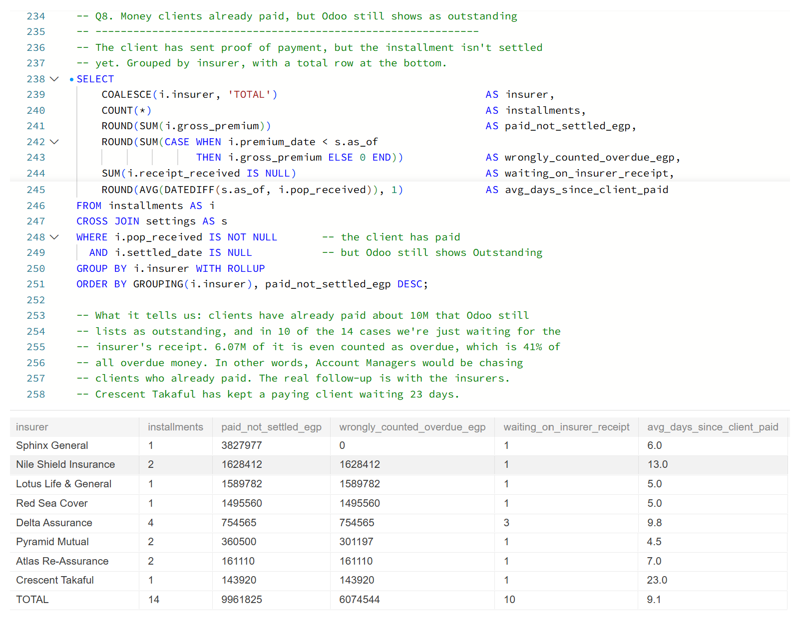

# Insurance Collections Insights - Where Payments Get Stuck

### SQL analysis (MySQL) · an insurance broker case study

> **The real question isn't "why is this premium late?" but "who's holding it?"** The same overdue total splits into four queues: waiting on the broker's review, on the insurer, on the client, or on finance. Each needs a different person to act. In this data, 41% of "overdue" premiums (EGP 6.07M) were already paid by clients and stuck waiting on insurer receipts, so the follow-up belonged with insurers, not clients.

**SQL data analysis of insurance premium collections and accounts receivable in MySQL**: data cleaning in SQL, CTEs, window functions, aging and on-time payment analysis, and a hypothesis test.

Eight business questions about insurance premium collection at a broker, answered in SQL: where money gets stuck, which insurers slow things down, and whether **late invoices cause late payments** (they do).

> Built on **mock data** that mirrors a real Odoo export and the real collection process I worked with at an insurance broker. No real client data is used.

---

## The questions and answers

| # | Question | Answer |
|---|---|---|
| Q1 | Where is the outstanding money stuck, and who has to act? | Of 24M already in progress, 11.1M waits on clients and **9.3M waits on insurers' receipts** |
| Q2 | Which client groups hold the overdue money? | **3 of 11** key accounts hold **58%** of it |
| Q3 | Which insurers are slowest? | Red Sea Cover at breakdowns (7.3 days); Atlas Re-Assurance at receipts (10 days) |
| Q4 | Who sends wrong documents most often? | 44% of breakdowns are wrong; **Medical is worse than Life for every insurer** (50% vs 33%) |
| Q5 | Is on-time payment improving? | Dips to ~46% at year-end, recovers to 69% by Aug 2026, falls to 32% in Sep 2026 |
| Q6 | **Hypothesis:** do late invoices cause late payment? | **Yes.** 10+ days' notice → 78% paid on time; invoice after the due date → 0% |
| Q7 | How often do we request breakdowns late? | 13% of requests; only 14% of those paid on time vs 61% |
| Q8 | How much "overdue" money has the client already paid? | **6.07M (41% of overdue)**, mostly waiting on insurer receipts |

## Highlights

**Where the money is stuck (Q1).** `CASE WHEN` turns eight process dates into one stage label.


**Hypothesis test (Q6).** The more notice a client gets, the more likely they pay on time.


**Paid but not settled (Q8).** Clients who already paid, still counted as overdue, with a `WITH ROLLUP` total.


## The data

The same mock dataset as the Power BI project: 487 raw installment rows in the layout of an Odoo outstanding-premiums export, plus one date per step of the collection chain (breakdown requested → received → confirmed → invoice → sent to client → client pays → insurer receipt → settled).

The raw data is loaded **with its export quirks** (extra spaces, `False` key accounts, duplicates, refunds) and cleaned in SQL.

## How to run it

1. Install MySQL Server 8.4+ and MySQL Workbench.
2. Run `sql/01_create_and_load.sql`: creates the `premium_tracker` database and loads 487 raw rows.
3. Run `sql/02_clean.sql`: builds the clean `installments` table (481 rows) and a `settings` table holding the snapshot date (17 Nov 2026).
4. Run the queries in `sql/03_analysis.sql` one at a time. Each one has its business question above it and a plain-language insight below it.

## Cleaning in SQL

| Problem in the export | Fix |
|---|---|
| Extra spaces in names | `TRIM()` |
| Empty key account exported as `False` | `CASE WHEN` → `NULL`, then filled from the customer's other rows with a `LEFT JOIN` + `COALESCE` |
| Duplicate lines | `SELECT DISTINCT` |
| Refunds (negative amounts) | `WHERE gross_premium > 0` |
| "Today" changing the results | A `settings` table with a fixed as-of date |

**Check:** 481 rows, 45 customers, 0 missing key accounts, 263.4M total due, matching the Power BI model exactly.

## SQL skills shown

`GROUP BY` and aggregates · `CASE WHEN` · conditional aggregation (`AVG(CASE WHEN …)`) · `DATEDIFF`, `DATE_FORMAT` · `CROSS JOIN` / `LEFT JOIN` · CTEs (`WITH`) · window functions: `RANK()`, running totals, a rolling 3-month window (`WINDOW … ROWS BETWEEN 2 PRECEDING`) · `WITH ROLLUP` and `GROUPING()`

## Notes and limitations

- **Calendar vs working days:** SQL's `DATEDIFF` counts calendar days, while the Power BI measures use working days, so turnaround values differ between the two projects but rank insurers almost identically.
- **Mock data:** relationships like Q6 come from process experience built into the data; with real data, I'd also control for client size and insurer.
- **Small samples:** some insurers have only 16–17 reviews, so their error rates can swing.

## Files

```
├── sql/
│   ├── 01_create_and_load.sql
│   ├── 02_clean.sql
│   └── 03_analysis.sql
├── data/
│   ├── mock_premium_report.xlsx   # the same raw data (already inside 01_create_and_load.sql)
│   └── generate_mock_premiums.py  # recreates the data exactly (seed 77)
└── screenshots/
```

## Related project

**Power BI dashboard on the same data:** [insurance-collections-insights-power-bi](https://github.com/alytareq101/insurance-collections-insights-power-bi): an overview page and an action list showing who has to act today.

---

**Author:** Aly Tarek · [LinkedIn](https://www.linkedin.com/in/aly-tarek-432245411)
**Tools:** MySQL 8.4 · MySQL Workbench · Python (mock data generation)

**GitHub topics:** `sql` `mysql` `data-analysis` `data-cleaning` `cte` `window-functions` `insurance` `accounts-receivable` `collections` `business-analysis` `portfolio-project`
